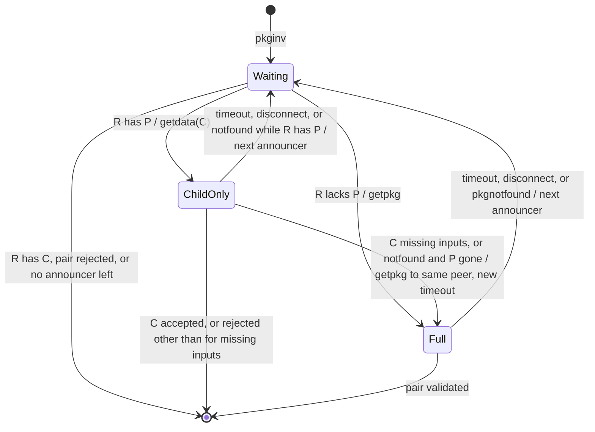

```
  BIP: ?
  Layer: Peer Services
  Title: One-Parent-One-Child Package Relay
  Authors: Greg Sanders <gsanders87@gmail.com>
  Status: Draft
  Type: Specification
  Assigned: ?
  License: BSD-2-Clause
  Discussion: 2026-09-28: https://gist.github.com/instagibbs/880a76535fd802fced9f9a5253cdbb40
              2026-10-12: https://github.com/bitcoin/bitcoin/pull/36506
  Requires: 133, 144, 339, 434
```

## Abstract

This BIP defines peer-to-peer messages for relaying a transaction together with its parent. The
sender announces the parent and child as a pair; the receiver requests both and validates them as a
package. With it, one honest peer can get such a pair into a node's mempool when the parent alone
pays less than the node's minimum feerate, or when replacing a conflicting transaction needs the
fees of both (package RBF), even if the node's other peers try to keep the pair out. Replacement
rules apply as usual, so a conflicting transaction can still replace the parent or the child. The
sender pairs a parent only with its only unconfirmed child, so a second child of the parent, which
TRUC ([BIP 431][BIP431]) rules out, also stops the pair from being announced.

## Motivation

A node rejects a transaction whose feerate is below its mempool minimum. A child can pay enough for
both (child pays for parent, CPFP), but only if the node validates the two together. CPFP is common,
including in layer 2 protocols that pre-sign transactions.

Bitcoin Core since v28.0 relays such pairs opportunistically. The child is announced and downloaded on
its own, fails for a missing input and is kept in the orphanage. The node then requests the parent
from the peers that announced the child, and validates the two as a package once the parent fails
alone for its feerate. This relies on per-transaction state that other peers can influence,
including:

- Reject caches keyed by txid or wtxid. A peer can send a copy of the parent or child with a stripped
  or altered witness, or the child without its parent, so that a later honest copy is skipped.
- The orphanage and the per-transaction request tracker, which track which peers announced or sent
  each transaction.
  A peer can evict the honest child from the orphanage, or deliver its own version of a transaction
  so that the honest one is never requested.

Examples are collected in a [companion writeup][holes] linked from [bitcoin/bitcoin#36506][36506].
The orphanage must also stay small to bound memory, which limits how many pairs can be in flight at
once.

The sender already knows that a transaction depends on a parent. This BIP lets it announce the two
as one item, which the receiver requests, downloads and validates as a unit. The receiver caches a
rejection only by the exact pair of wtxids. Copies of either transaction that a peer sends or
withholds do not stop the receiver from requesting and validating the pair.
[Properties](#properties) states what a receiver gets from one honest announcer, and under which
conditions.

The BIP covers one parent and one child only. Larger packages are left to future work.

## Specification

This section covers messages and the behavior a peer can observe. What else an implementation needs
for the outcomes under [Properties](#properties) is described in
[Implementation notes](#implementation-notes).

The key words "MUST", "MUST NOT", "REQUIRED", "SHOULD", "SHOULD NOT", "RECOMMENDED", "MAY", and
"OPTIONAL" in this document are to be interpreted as described in BCP 14 (RFC 2119 and RFC 8174)
when, and only when, they appear in all capitals, as shown here.

### Definitions

- A *pair* (P, C) is a parent P and a child C, identified by their two wtxids in that order. Pairs
  whose parents or children differ only in their witnesses are different pairs.
- C *spends* P if at least one input of C refers to an output of P: by P's txid, and an output index
  less than the number of P's outputs.
- A node *can pair* C with P if, in its mempool, P is C's only unconfirmed parent, P has no
  unconfirmed parents, and C is P's only unconfirmed child.
- A node *serves* a transaction to a peer if it would answer a `getdata` for its wtxid from that
  peer with the transaction ([BIP 339][BIP339]).

### Negotiation

Package relay is negotiated with a [BIP 434][BIP434] `feature` message:

| Field         | Value |
| ------------- | ----- |
| `featureid`   | `github.com/instagibbs/bitcoin/pkgrelay-1p1c/draft1`, until a BIP number is assigned |
| `featuredata` | empty; a receiver ignores its contents |

- A node implementing this BIP SHOULD send the `feature` message to every peer eligible for
  `feature` messages under BIP 434. It MAY omit it on connections it knows carry no transactions in
  either direction, such as block-relay-only connections it opened.
- Package relay is enabled on a connection if both peers sent the `feature` message and both sent
  `wtxidrelay` ([BIP 339][BIP339]). Each peer decides this on receiving the other's `verack`.
- The messages defined below MUST NOT be sent on a connection on which package relay is not
  enabled. A node receiving any of them on such a connection MAY ignore it or disconnect the sender.
- A node MUST NOT send `pkginv` to a peer while it would not announce transactions to that peer with
  `inv`, as the peer's `version` relay flag and [BIP 37][BIP37] messages determine. It SHOULD NOT
  send `pkginv` to a peer with a BIP 37 filter loaded, and announces matching transactions with
  `inv` instead. Replies to `mempool` ([BIP 35][BIP35]) use `inv`.
- A node that does not accept transactions from a peer, such as a node in blocks-only mode, sends
  that peer no `getpkg`, and MAY disconnect it for sending `pkginv` or `pkg`, as it may for `inv`
  and `tx`.

### Messages

`pkginv`, `getpkg` and `pkgnotfound` carry a list of pair entries:

| Type        | Name    | Description |
| ----------- | ------- | ----------- |
| CompactSize | `count` | Number of entries |
| entry[]     | `pairs` | `count` entries of 64 bytes |

Each entry is:

| Type     | Name     | Description |
| -------- | -------- | ----------- |
| char[32] | `parent` | wtxid of P, in the byte order of `inv` hashes |
| char[32] | `child`  | wtxid of C, in the same byte order |

A node SHOULD NOT send any of these three messages with no entries, and SHOULD ignore one that has
none.

#### `pkginv`

Announces pairs.

- A `pkginv` message MUST NOT contain more than 1000 entries. A node receiving one with more MAY
  disconnect the sender.
- In each entry, C MUST spend P. A node MAY disconnect a peer that violates this.
- A node SHOULD NOT announce a pair whose feerate, min(feerate(C), feerate(P and C together)), is
  below the peer's `feefilter` ([BIP 133][BIP133]). As in BIP 133, a pair announced below the filter
  is not a protocol violation.
- A node SHOULD announce a transaction C in a pair (P, C), instead of with `inv`, if it can pair C
  with P and the pair meets the peer's `feefilter` as above. It need not announce P with `inv` in
  the same batch. Unconfirmed children of C are announced on their own and play no part in pairing
  or in the `feefilter` check.
- After announcing a pair, a node MUST serve P and C to the peer as it would if it had announced
  them with `inv`.

#### `getpkg`

Requests pairs.

- A `getpkg` message MUST NOT contain more than 100 entries. A node receiving one with more MAY
  disconnect the sender.
- A node SHOULD answer each entry of a `getpkg` from a peer it announces transactions to: either
  with a `pkg` message, if it serves both P and C to the peer, or by listing the pair in a
  `pkgnotfound` message. It MUST NOT answer an entry more than once. The order of the answers is not
  specified. It MAY serve a pair it did not announce, whether or not C spends P.

#### `pkg`

The two transactions of a requested pair:

| Type | Name     | Description |
| ---- | -------- | ----------- |
| tx   | `parent` | P, with witness serialization ([BIP 144][BIP144]) |
| tx   | `child`  | C, with witness serialization |

- The pair is (wtxid of `parent`, wtxid of `child`).
- A node MUST NOT send `pkg` except in reply to a `getpkg` entry for that pair. A node SHOULD ignore
  a `pkg` that does not match a `getpkg` entry it has outstanding to that peer. It SHOULD NOT
  disconnect the sender for it.
- A node MAY disconnect a peer that announced a pair and then answers a `getpkg` for it with a `pkg`
  in which C does not spend P.

#### `pkgnotfound`

Lists pairs from `getpkg` entries the node does not serve.

- A `pkgnotfound` message MUST NOT contain more than 100 entries. A node MAY ignore one with more.
- After listing in `pkgnotfound` a pair (P, C) that it announced to the peer, a node SHOULD announce
  with `inv` each of P and C that:
  - is still in its mempool;
  - it would announce to the peer with `inv`, as the peer's `feefilter`, relay flag and any BIP 37
    filter allow;
  - the peer has not announced or sent to the node, in `inv`, `pkginv`, `tx` or `pkg`; and
  - the node has not announced or sent to the peer, in `inv` or `pkg`. The node's own `pkginv`
    entries, and `tx` messages it sent in reply to `getdata`, do not count.

  It does so even if it also announces P or C in a new pair. A node SHOULD NOT announce transactions
  this way for a pair it did not announce to the peer.

### Requesting only the child

A node that received `pkginv` for (P, C) and has a transaction with P's wtxid in its mempool MAY
request C alone, with `getdata` for C's wtxid instead of `getpkg`. The peer answers with `tx` or
`notfound`, as for any `getdata`.

If C then turns out to be missing inputs, or the answer is `notfound` and P is no longer in the
requester's mempool, the requester SHOULD request the pair with `getpkg` from the same peer. The
requester SHOULD send at most one such `getpkg` per announcement, whatever its answer.

### Test vectors

Message payloads, without the message header. P spends output 0 of a transaction with txid
`1111…11`; C spends output 0 of P. Both pay to a P2WSH output whose witness script is `OP_TRUE`, and
spend with that script as the only witness item. Both are version 2, with nSequence 0xfffffffd and
nLockTime 0; P pays 10,000 sat to its output and C 9,000 sat. Ids are shown in the byte order of RPC
output. `getpkg` and `pkgnotfound` entries are serialized as in `pkginv`.

| Item | Value |
| ---- | ----- |
| P txid  | `8b00fe39967f29139f8d03498da3dc3c548a96028449a31b4ebb0c3629b50761` |
| P wtxid | `b91a8506a312c420747e7ad71856008a99d243c46e2f67f69ca17d871bba888f` |
| C txid  | `b441cde3cd0cb81a349d9097d551b9f53d39712a9dbae4b62cffd2d390d37181` |
| C wtxid | `8df0d83ee566756891a7dbdcd760a42307587045b9fecd4a6137fd6f50e5b7e5` |

`pkginv` with the entry (P, C):

```
018f88ba1b877da19cf6672f6ec443d2998a005618d77a7e7420c412a306851ab9e5b7e5506ffd37614acdfeb94570580723a460d7dcdba791687566e53ed8f08d
```

`pkg` with P and C:

```
0200000000010111111111111111111111111111111111111111111111111111111111111111110000000000fdffffff0110270000000000002200204ae81572f06e1b88fd5ced7a1a000945432e83e1551e6f721ee9c00b8cc3326001015100000000020000000001016107b529360cbb4e1ba3498402968a543cdca38d49038d9f13297f9639fe008b0000000000fdffffff0128230000000000002200204ae81572f06e1b88fd5ced7a1a000945432e83e1551e6f721ee9c00b8cc3326001015100000000
```

## Properties

This section is informational.

Let H and R be nodes that follow the Specification, including its recommendations, with R also
following the [receiver notes](#receiver). Suppose H can pair C with P, the pair meets R's
`feefilter`, and H announces it to R after R has left initial block download. R then gets into its
mempool, unless a block confirms it first, whatever its other peers do short of replacement:

- the pair, as long as H can serve it;
- otherwise P alone, if P pays for itself and H no longer has C;
- otherwise C alone, if a block confirms P.

The second and third outcomes come through H's fallback `inv` and R's single-transaction relay, so
they need the remaining transaction to meet R's `feefilter` at that time, and are only as robust as
that relay.

If H's P is replaced, or H's C is replaced and P does not pay for itself, H has nothing left to
relay. Nothing here protects against replacement: a transaction from any peer that conflicts with P
or C can keep the pair, or what is left of it, out of R's mempool, or evict it later, whenever R's
replacement rules allow. A copy of P or C with a different witness that R accepted first is kept in
place of H's.

These outcomes assume that H answers each request in time, that R's chain includes the tip at which
H accepted the pair by the time H's announcement reaches R, and that R's policy accepts the pair. If
the pair is not yet valid at R's tip, a delivery from any announcer fails, and R drops all its
announcements of the pair, H's included. A large backlog of other pairs requested from H over a slow
link can delay an answer past R's timeout. Anyone who can spend another output of P can give it a
second child, so that H no longer pairs C with P. A TRUC parent rules this out, since a second child
must replace the first.

As with single-transaction relay:

- H does not announce P or C on its own to R if either already announced it to the other, so a
  transaction R had and later evicted is not covered.
- An attacker that keeps opening new connections can delay delivery from an inbound-only H with no
  fixed bound.
- R tracks a limited number of announcements from each peer, and does not request a pair H
  announces while H is at that limit.

## Implementation notes

This section is informational. Each note states a mechanism of the reference implementation and the
outcome it supports.

### Receiver

1. Skip a pair only if C is in R's mempool or recently confirmed, or R has rejected the pair itself.
   Per-transaction reject caches and the orphanage play no part, either in deciding to request a
   pair or in handling one that arrives: R validates a delivered pair, or a child it requested
   alone, whatever those caches hold for P or C, and records a failure against the pair only. A
   child requested alone whose inputs are missing is not kept as an orphan. This way nothing a peer
   does with P or C alone, such as sending a copy with a different witness or the child without its
   parent, stops R from requesting or accepting the pair.
2. Key the pair reject cache by both wtxids, and clear it at each new tip. This way a pair with a
   malleated parent cannot block the real one, and a failure that depends on R's chainstate, such
   as a parent that spends from a block R has not connected yet or is not yet final at R's tip, does
   not stop R from requesting announcements of the pair that arrive after its next tip.
3. Track requests by pair, apart from requests for single transactions. Request a pair from one
   announcer at a time, preferring announcers on outbound connections, with a timeout. Move to the
   next announcer on timeout, on disconnection, or when that announcer answers `pkgnotfound`,
   or answers `notfound` to a request for the child alone while R still has P. Answers from other
   peers, and requests for P, C or another pair that shares one of them, do not affect the request.
   An announcer asked for the pair after a request for the child alone gets a new timeout. This way
   an announcer that does not deliver delays the request to the next announcer by at most two
   timeouts, and announcements of P or C in another form do not delay it.
4. Treat a `tx` as the delivery of a child requested alone only if it answers such a request that R
   has outstanding to the peer that sent it, as under [`pkg`](#pkg) for a pair. This way a peer R
   did not ask can neither deliver a pair nor end R's request for it.
5. Try P, then C, on their own, and validate together only what failed alone for its feerate or for
   missing inputs, as Bitcoin Core's package validation does. This way a parent that pays for itself
   is kept when its child fails, and a child is accepted when its parent is already confirmed,
   unless the two together exceed R's package limits.

The request for one pair at R, as notes 1, 3 and 4 describe it:



### Sender

1. Record the pairs announced to a peer in state that only the node's own `pkginv` writes. The
   record decides the `pkgnotfound` fallback. If the peer could mark a pair as announced, for
   example through a known-inventory filter that the peer's `inv` also writes, a `getpkg` for that
   pair would get any two transactions in the sender's mempool announced to the peer. If the record
   can return false positives, as a Bloom filter does, also check that a `getdata` would get each
   transaction before announcing it in the fallback.
2. Send `pkginv` with the same delays and batching as `inv`. Announcing pairs sooner than single
   transactions would point to their origin.
3. As with `getdata`, serving `getpkg` needs send-buffer backpressure: one message can ask for up to
   100 pairs of the largest standard transactions.
4. Pair only transactions that weigh at most 404,000 weight units together, Bitcoin Core's package
   weight limit. A receiver rejects a heavier pair as a package without trying either transaction
   alone, and a sender whose cluster limit is above the default can hold one.

## Rationale

**Why the sender starts.** The sender knows the child's ancestors; the receiver only learns them by
downloading the child, failing it, and asking. Receiver-initiated designs, such as the
orphanage-based relay described above and the ancestor package relay of [BIP 331][BIP331], need the
child held somewhere while the ancestors are fetched, or downloaded again afterwards. Holding it is
the per-transaction state that peers can interfere with, and downloading it again wastes bandwidth.
With the pair announced up front, one request and one reply carry it, and the receiver holds no
transaction while it waits for the reply. BIP 331 is not deployed, and this BIP does not use its
messages.

**Why one parent and one child.** It matches TRUC ([BIP 431][BIP431]) and the packages Bitcoin Core
already relays through the orphanage. Pairing only when P has no unconfirmed parents and is C's only
unconfirmed parent lets the receiver validate the pair against its chainstate alone. With another
unconfirmed ancestor, the outcome would depend on whether the receiver happens to have it, which
other peers can influence. Pairing only a parent's only child stops a sender from making the
receiver download P once per child, as it would for a parent with several unconfirmed children, such
as a batch payment whose outputs are spent before it confirms. Each such pair would pay for both its
transactions, so this is not a denial-of-service concern, but the repeated copies of P are wasted
bandwidth. Such a parent and its children are relayed as they would be without this BIP. The rule is
per sender: peers whose mempools hold different children of P, because the children conflict or have
not yet propagated, each pair P with their own, and a receiver that requests those pairs before it
has P downloads P from each. Once it has P, it requests further children alone. A larger package
would need the announcement to describe a topology the receiver cannot check before downloading.

**Why each direction follows transaction relay.** A node in blocks-only mode accepts no
transactions from its peers but still broadcasts its own, and no other node has those pairs to
announce. Each direction of package relay follows that direction's transaction relay, so such a node
can announce its pairs while its peers send it none.

**Why both wtxids in each entry.** The receiver learns enough from the announcement to skip a pair
whose child it has, to check its cache of rejected pairs, and to choose between requesting both
transactions and requesting the child alone, without another round trip. The announcement is also
bound to the exact parent. The cost is 28 bytes more than an `inv` entry on links where P was
announced first. In 2026, with about 5% of transactions pairable, that came to about 0.4-0.7% of a
node's transaction relay bytes with 8 peers, and 2-3% with 100 peers. Shorter forms were considered.
A single pair hash needs an index of the mempool by pair, which misses a child the receiver has once
P is confirmed. It also leaves the receiver unable to tell whether it has P, so it either downloads
P again or spends an extra round trip when it lacks P. A short prefix of the parent's wtxid weakens
the binding to the parent: with 4 bytes, an attacker can find a parent that shares the honest pair's
identifier and get it rejected. In `getpkg` and `pkgnotfound`, a pair hash would save 32 bytes per
request, but the sender would have to remember every pair it announced to resolve it, and the
fallback after `pkgnotfound` would not know which transactions to announce.

**Which feerate is compared with `feefilter`.** The receiver cannot check a feerate before
downloading the pair, so `pkginv` carries none, and the sender applies the receiver's `feefilter`
instead. It compares the feerate at which a miner would take C. If C pays a higher feerate than P, a
miner takes the two together, at their combined feerate; otherwise P is worth taking without C, and
C adds only its own. Both cases give min(feerate(C), feerate(P and C together)). The combined
feerate alone would let a high-fee parent carry a child below the filter, and C's feerate alone
would announce pairs whose combined feerate is below it.

**Why disconnect for a non-spending pair, but not for an unrequested `pkg`.** Whether C spends P
depends only on the two transactions, not on anyone's chainstate or mempool, so an honest peer never
announces a pair in which C does not spend P. A slow honest peer can send a `pkg` for a request the
receiver has given up on. Every other disconnect the specification allows is likewise for something
an honest peer never sends.

**Why the fallback after `pkgnotfound`.** A sender that pairs C with P announces neither on its own
in that batch. If the pair later cannot be served, because C was replaced by a transaction that does
not spend P or because a block confirmed P, the transaction left over may still be worth relaying: P
if it pays for itself, or C once P is confirmed. Without the fallback the receiver would never hear
of it from this sender, and anyone able to make the pair unservable, for example by replacing C,
could keep a parent that pays for itself from reaching the receiver that way. For the same reason
the fallback announces P with `inv` even when the sender pairs P with a new child: otherwise anyone
replacing P's child each time the receiver requests the pair could keep P from reaching it. The
fallback gives the second and third outcomes under [Properties](#properties). The sender's own
`pkginv` entry does not count as having announced P or C, since otherwise the pair announcement
would itself suppress the fallback. Nor does a `tx` sent in reply to `getdata`: the receiver drops a
child requested alone whose parent it no longer has.

**Why `getdata` for the child alone.** It needs no new message: the sender already answers
`getdata` for transactions it announced. When the receiver already has P, sending P again would
roughly double the bytes for the pair; requesting the child alone costs about as much as relaying
it with `inv`. The shortcut assumes the receiver still has P when C arrives. A peer can break that
by relaying P and getting it evicted in between, so the receiver then asks the same announcer for
the full pair, rather than counting C as failed or giving up on that announcer. If C was
`notfound`, the sender answers that `getpkg` with `pkgnotfound` and falls back to announcing P.

**Privacy.** `getpkg` reveals no more than `getdata`: a pair is served only if both its
transactions would be served to `getdata`, and the fallback after `pkgnotfound` applies only to
pairs the sender announced to that peer. For announcement timing, see the [sender notes](#sender).

## Backward compatibility

Nodes that do not implement this BIP are unaffected. BIP 434 requires them to ignore the unknown
`feature` message, and none of the messages defined here are sent to them. A node implementing this
BIP keeps relaying transactions with `inv` to such peers, and keeps any other way of relaying pairs
it has, such as the orphanage-based relay described in the motivation.

## Reference implementation

https://github.com/instagibbs/bitcoin/tree/2026-10-1p1c-pkg-relay

## Acknowledgements

Thanks to those who built and deployed opportunistic 1p1c package relay, which this BIP builds on:

* Gloria Zhao
* Suhas Daftuar
* Pieter Wuille
* Abubakar Ismail

## Copyright

This BIP is licensed under the BSD 2-clause license.

[36506]: https://github.com/bitcoin/bitcoin/pull/36506
[holes]: https://gist.github.com/instagibbs/880a76535fd802fced9f9a5253cdbb40
[BIP331]: https://github.com/bitcoin/bips/blob/master/bip-0331.mediawiki
[BIP431]: https://github.com/bitcoin/bips/blob/master/bip-0431.mediawiki
[BIP35]: https://github.com/bitcoin/bips/blob/master/bip-0035.mediawiki
[BIP37]: https://github.com/bitcoin/bips/blob/master/bip-0037.mediawiki
[BIP133]: https://github.com/bitcoin/bips/blob/master/bip-0133.mediawiki
[BIP144]: https://github.com/bitcoin/bips/blob/master/bip-0144.mediawiki
[BIP339]: https://github.com/bitcoin/bips/blob/master/bip-0339.mediawiki
[BIP434]: https://github.com/bitcoin/bips/blob/master/bip-0434.md
